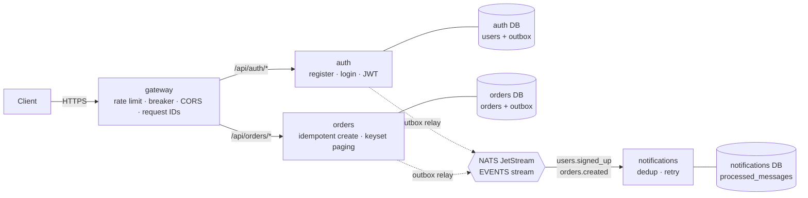

# go-microservices-kit

[](https://github.com/shani8615/go-microservices-kit/actions/workflows/ci.yml)

A small but realistic **Go microservices reference**: an API gateway, auth, orders and notifications. Each service has its own Postgres database, and they share events over NATS JetStream through a **transactional outbox**. It aims to show the patterns that matter in production, not to cover every feature.



## What it demonstrates

| Pattern | Where |
|---|---|
| Database per service | `deploy/init-databases.sql`; each service owns its schema |
| Transactional outbox (no lost or phantom events) | `services/*/store.go` + [go-outbox](https://github.com/shani8615/go-outbox) |
| Idempotent POST with per-user key scoping | `services/orders` + [go-httpkit/idempotency](https://github.com/shani8615/go-httpkit) |
| Idempotent consumer (dedup by message ID) | `services/notifications` |
| Broker-side de-duplication (`Nats-Msg-Id`) | `internal/natsbus` |
| Circuit breaker + per-client rate limiting at the edge | `services/gateway` + [go-resilience](https://github.com/shani8615/go-resilience) |
| Defense in depth: every service verifies the JWT itself | `internal/token` |
| Prices come from the server, never the client | `services/orders` (unknown fields rejected) |
| Keyset pagination with opaque cursors | `GET /api/orders` |
| Graceful shutdown, health and readiness probes, DB startup retry | `internal/platform` |
| Structured logs with no secrets/PII (no query strings, bodies or emails) | `go-httpkit/middleware.Logger`, `LogNotifier` |

## Run it

```bash
cp .env.example .env          # fill in JWT_SECRET (openssl rand -base64 48) and POSTGRES_PASSWORD
make tidy                     # first time only: resolves deps and writes go.sum
make up                       # builds 4 images, starts Postgres + NATS
make demo                     # register → login → order twice with the same Idempotency-Key → list
make logs                     # see the "notification sent" lines
```

## API (via the gateway on :8080)

| Method | Path | Auth | Notes |
|---|---|---|---|
| POST | `/api/auth/register` | – | `{"email","password"}` (12–128 chars) |
| POST | `/api/auth/login` | – | returns `access_token` (15 min) |
| GET | `/api/auth/me` | Bearer | |
| POST | `/api/orders` | Bearer | `{"sku","quantity"}`, optional `Idempotency-Key` |
| GET | `/api/orders?limit=&cursor=` | Bearer | your orders only, newest first |
| GET | `/api/orders/{id}` | Bearer | 404 if it isn't yours |

Errors use RFC 9457 `application/problem+json`.

## Layout

```
cmd/<service>/main.go     wiring only: config, DB, bus, HTTP server
services/<service>/       handlers, store interface, Postgres + in-memory stores, tests
internal/platform         config, logging, DB connect with retry, graceful shutdown
internal/token            HS256 JWT (stdlib) + RequireAuth middleware
internal/natsbus          JetStream publisher (outbox.Publisher) and durable consumer
internal/events           event contracts shared between services
```

Each service's tests run against in-memory stores, so `go test ./...` needs no Docker.

## Production notes / roadmap

- Replace HS256 shared-secret tokens with EdDSA/RS256 + JWKS so services only hold public keys.
- Move idempotency records to Redis or Postgres when orders runs more than one replica.
- Add OpenTelemetry tracing (propagate `traceparent` through outbox headers) and Prometheus metrics.
- Use versioned migrations (goose / atlas) instead of `CREATE TABLE IF NOT EXISTS` at startup.
- Add Kubernetes manifests / Helm chart.

## License

MIT
